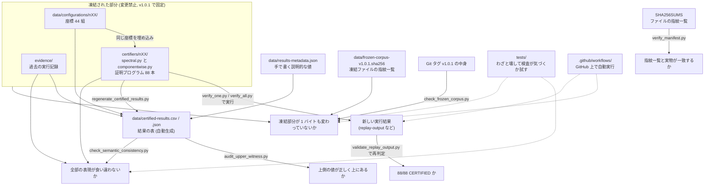

# Architecture

このリポジトリが何をしていて、どのファイルが何の役目を持つかを、持ち主本人が読み返せるように日本語でまとめた解説書です。
用語は `docs/GLOSSARY.md` にまとめてあります。

- 書き方: 実際にファイルを開いて読んだ内容と、実際にコマンドを実行した結果だけを書いています。
- 根拠: 各説明のあとに「根拠」として、ファイルのパスとおおよその行番号を書いています（`ファイル:行`）。
- 読んでいない部分: 中身（関数の本体）まで読まずに、冒頭の説明文（docstring）や関数の一覧だけを読んだものは **未確認** と明記しています。
- 対象の版: ブランチ `audit/v1.0.2-upper-witness-hardening` のコミット `b57c436` 時点。`VERSION` は `1.0.1` のまま、`CHANGELOG.md` に未リリースの変更が「Unreleased」として書かれている状態です。

## 1. ひとことで言うと

正方形 `[0,1]^2` の中に `n` 個の点光源を置いたとき、正方形の中で「一番暗い場所の明るさ」が少なくともいくら以上あるかを、**丸め誤差のない分数計算で証明するプログラム集**です。

- 明るさは「各光源からの距離の 2 乗の逆数の合計」で計ります（根拠: `README.md:7-17`、`certifiers/n15/spectral.py:6-10`）。
- 証明するのは「この決まった座標の配置なら、一番暗い場所でもこの値以上」ということだけです。「これが世界一良い配置だ」という証明ではありません（根拠: `README.md:44-50`、`docs/claim-boundaries.md`）。
- 対象は 44 通りの `n`（`7, 8, 10, 11, 12` と `14` から `52` まで）で、それぞれに証明プログラムが 2 本あり、合計 88 本です（根拠: `README.md:33`、`scripts/certificate_lib.py:53`）。

## 2. 全体の図

図の読み方: 上の枠の中（座標・証明プログラム・過去の実行記録）が「数学の本体」で、v1.0.1 のときの中身から変えてはいけない部分です。その外側にあるスクリプトはすべて、本体を **読む・実行する・照らし合わせる** ための道具で、本体を書き換えることはしません。例外は結果の表（`data/certified-results.*`）で、これは本体から自動で作り直されます。

## 3. ファイルごとの役割

追跡されているファイルは 601 個です（`git ls-files | wc -l` で確認）。同じ形のファイルが `n` ごとに並んでいる 4 種類はまとめて 1 行にし、残りは 1 つずつ書きます。

### 3.1 数学の本体（凍結。変更禁止）

| パス | 数 | 役割 | 根拠 |
| --- | ---: | --- | --- |
| `certifiers/nXX/spectral.py` | 44 | 証明プログラム（スペクトル法）。座標・目標値 `TARGET` を分数で埋め込み、正方形を小さな箱に分けながら「どの箱でも明るさは `TARGET` 以上」を確かめる。最後に `status: CERTIFIED` などを表示し、自分の結果を `assert` で再確認する | `certifiers/n15/spectral.py:1-32`（説明）, `:97-139`（箱ごとの下限）, `:152-207`（分割の繰り返し）, `:219-246`（表示と最後の確認） |
| `certifiers/nXX/componentwise.py` | 44 | 証明プログラム（成分ごと法）。同じ座標・同じ `TARGET` を使い、2 次の誤差の見積もり方だけが違う | `certifiers/n15/componentwise.py:1-13`, `:86-123`, `:144-168`, `:176-196` |
| `data/configurations/nXX/coordinates.csv` | 44 | 光源の座標（`index,x,y` の表）。証明プログラムに埋め込まれた座標と一致することが検査される | `data/configurations/n15/coordinates.csv:1-5`、`scripts/regenerate_certified_results.py:92-103` |
| `data/configurations/nXX/coordinates-source.txt` | 44 | 同じ座標の、空白区切りの元テキスト | `data/configurations/n15/coordinates-source.txt:1-8`、`scripts/certificate_lib.py:500`（読み込み関数。本体は未確認） |
| `evidence/saved-replays/nXX/spectral.txt` と `componentwise.txt` | 88 | 証明プログラム 1 本ごとの、過去に保存した画面出力 | `evidence/saved-replays/n15/spectral.txt:1-12` |
| `evidence/full-cleanroom-replay/logs/nXX_<method>.stdout.txt` / `.stderr.txt` / `.meta.json` | 264 | 88 本を新しく展開した複製から一度に実行した記録（画面出力・エラー出力・実行情報） | `evidence/full-cleanroom-replay/logs/n15_spectral.meta.json` |
| `evidence/full-cleanroom-replay/PUBLIC_REPO_FULL_REPLAY.json` | 1 | 上の 88 本の実行のまとめ（88/88 成功、4 並列、合計 1901 秒など） | 同ファイル冒頭、`scripts/check_release.py:14-20` |
| `evidence/full-cleanroom-replay/PUBLIC_REPO_FULL_REPLAY.csv` | 1 | 同じまとめの CSV 版 | 同ファイル 1-3 行 |
| `evidence/full-cleanroom-replay/PUBLIC_REPO_FULL_REPLAY.md` | 1 | 同じまとめの人間向けの表 | 同ファイル 1-20 行 |

凍結の対象は `certifiers`、`data/configurations`、`evidence/full-cleanroom-replay`、`evidence/saved-replays` の 4 か所、合計 531 ファイルです（根拠: `scripts/check_frozen_corpus.py:82-87`、`docs/frozen-corpus.md:5-12`、実行結果 `baseline_entries=531`）。

### 3.2 データ（表とその材料）

| パス | 役割 | 根拠 |
| --- | --- | --- |
| `data/certified-results.csv` | 44 行の結果の表（下限・上側の値・幅・分割回数・外部での状態など）。**手で編集してはいけない**。生成スクリプトが作る。改行は CRLF | `scripts/regenerate_certified_results.py:1-24`, `:165-175`、`docs/data-schema.md:1-11` |
| `data/certified-results.json` | 上と同じ内容の JSON 版 | `scripts/regenerate_certified_results.py:178-180` |
| `data/results-metadata.json` | 計算では出せない説明的な値（対称性の説明文、提出した値、局所最小の個数、表示の桁数など）。`n` をキーにした辞書 | `scripts/regenerate_certified_results.py:16-19`、`docs/data-schema.md:31-35` |
| `data/frozen-corpus-v1.0.1.sha256` | 凍結 531 ファイルの指紋（SHA-256）一覧。読みやすい写しであって、最終的な根拠は Git の v1.0.1 の中身 | 同ファイル冒頭のコメント、`docs/frozen-corpus.md:24-48` |
| `data/non-improvement-results.csv` | `n=9` と `n=13` で改善が見つからなかったことの記録（証明ではない） | 同ファイル全 3 行 |

### 3.3 スクリプト（`scripts/`）

すべて Python 標準ライブラリだけで動きます（各ファイルの docstring に `Dependencies: Python 3 standard library only.` とあり、`import` 文を確認）。

| パス | 役割 | 根拠 |
| --- | --- | --- |
| `scripts/verify_one.py` | 1 つの `n` の証明プログラムを実行し、成功の条件を満たすか判定する | `scripts/verify_one.py:1-60`（全部読んだ） |
| `scripts/verify_all.py` | 多数の証明プログラムを並列実行する。`--quick` は 5 つの `n`、`--all` は 44 すべて。`--output-dir` には空のフォルダを要求する | `scripts/verify_all.py:67-102`（対象の決定）, `:105-118`（空フォルダの要求）, `:155-246`（全部読んだ） |
| `scripts/verifier_runner.py` | 「成功」の判定ルール（成功契約）を 1 か所にまとめたもの。`-O` での実行を拒否する | `scripts/verifier_runner.py:1-48`, `:90-98`, `:117-142`, `:178-227`（全部読んだ） |
| `scripts/certificate_lib.py` | 共通の道具箱。分数での計算、上向きの丸め、証明プログラムを **実行せずに** 読んで定数を取り出す仕組み、出力の検査、厳密な JSON 読み込みなど | `scripts/certificate_lib.py:1-31`（説明）, `:53-58`（対象の `n`）, `:148`（上向き丸め）, `:540`（許可する import）。1888 行のうち読んだのは説明文・定数・関数一覧と一部の関数のみで、**本体の大半は未確認** |
| `scripts/check_frozen_corpus.py` | 凍結 531 ファイルが、Git の v1.0.1 の中身・指紋一覧・作業中のファイルの 3 つで一致するかを確かめる。`git replace` によるすり替えも無効化して読む | `scripts/check_frozen_corpus.py:1-55`（説明）, `:71-101`（定数）。関数の本体は **未確認** |
| `scripts/verify_manifest.py` | `SHA256SUMS` と実物を照らし合わせ、足りない・余分・不一致を探す | `scripts/verify_manifest.py:1-40`（前半のみ読んだ。後半は未確認） |
| `scripts/regenerate_manifest.py` | `SHA256SUMS` を作り直す | `scripts/regenerate_manifest.py`（全部読んだ） |
| `scripts/manifest_policy.py` | `MANIFEST_POLICY.json` を読み、指紋一覧に入れるファイルを決める | `scripts/manifest_policy.py:35-62`（全部読んだ） |
| `scripts/check_release.py` | 行数・フォルダ数・88/88・証明プログラムの指紋・`__pycache__` が無いことを数える簡易検査 | `scripts/check_release.py:1-25`（全部読んだ） |
| `scripts/check_semantic_consistency.py` | 座標・2 本の証明プログラム・表・過去の記録が、同じことを言っているかを照らし合わせる | `scripts/check_semantic_consistency.py:1-12`（説明）, `:699-727`（実行順）, `:213-230`。他の関数の本体は **未確認** |
| `scripts/regenerate_certified_results.py` | 結果の表を作る。`--check` は作った結果とファイルを比べるだけ、`--write` は書き込む | `scripts/regenerate_certified_results.py:82-230`（全部読んだ） |
| `scripts/audit_upper_witness.py` | 表の「上側の値」が、分数で計算し直した値より下になっていないか確かめる | `scripts/audit_upper_witness.py:49-155`（全部読んだ） |
| `scripts/validate_replay_output.py` | `verify_all.py` が書いた実行結果のフォルダを、自己申告を信じずに作り直して判定する | `scripts/validate_replay_output.py:1-40`（説明）, `:510-541`。関数の本体は **未確認** |

### 3.4 テスト（`tests/`）

テストの多くは、リポジトリの一時的な複製を作り、そこで 1 か所だけわざと壊して、検査がそれに気づくかを確かめる「変異テスト」です（根拠: `tests/support.py:1-33`）。本物のファイルは書き換えません。下の表は各ファイルの冒頭の説明とクラス名から書いたもので、**個々のテストの中身は未確認** です。

| パス | 何を確かめるか（冒頭の説明より） |
| --- | --- |
| `tests/support.py` | テスト用の補助。作業ツリーを一時フォルダへ複製し、スクリプトを `-B` 付きで実行する |
| `tests/test_success_contract.py` | 成功は「1 回だけ CERTIFIED と言い、正常終了したとき」だけ。`-O` の拒否、時間切れの扱い |
| `tests/test_upper_witness.py` | 表の上側の値が、正確な値以上であること。古い（切り捨て気味の）値に戻すと失敗すること |
| `tests/test_result_table_generation.py` | 表の生成が毎回同じになり、手で変えると `--check` が気づくこと |
| `tests/test_semantic_consistency.py` | 座標・証明プログラム・表・記録のどこを 1 か所壊しても検出されること |
| `tests/test_followup_hardening.py` | 第 2 回監査の対策（入口の形、上側の点の範囲、改行コードの保護など） |
| `tests/test_round3_hardening.py` | 第 3 回監査の対策（実行結果の 4 つの表現の突き合わせ） |
| `tests/test_round4_hardening.py` | 第 4 回監査の対策（入口の形、出力の中身、凍結一覧） |
| `tests/test_round5_hardening.py` | 第 5 回監査の対策（v1.0.1 の Git の中身を根拠にする、読み込み時の書き換え、ワークフローの約束） |
| `tests/test_round6_hardening.py` | 第 6 回監査の対策（`git replace` の無効化、ファイルの種類と権限、一覧の見出しの重複） |

### 3.5 リポジトリ直下のファイル

| パス | 役割 |
| --- | --- |
| `README.md` | 入口の説明。問題の定義、何を証明したか、再現手順（`README.md:52-71`） |
| `CHANGELOG.md` | 変更の記録。先頭の「Unreleased」が、このブランチでの未リリースの変更 |
| `VERSION` | 版番号 `1.0.1` |
| `CITATION.cff` | 引用するときの情報 |
| `CONTRIBUTING.md` | 協力するときの決まり（最適性を主張しない、個人情報や認証情報を入れない等） |
| `SECURITY.md` | 脆弱性の報告方法 |
| `LICENSE`, `LICENSE-CODE` | コードのライセンス（BSD-3-Clause）。2 つは同じ内容（`diff` で確認） |
| `LICENSE-DATA-DOCS.md` | データと文書のライセンス（CC BY 4.0） |
| `NOTICE.md` | 出典と、誰が何をしたかの説明 |
| `MANIFEST_POLICY.json` | `SHA256SUMS` に入れる範囲の定義（`certifiers`, `data`, `evidence`, `scripts`, `tests` と数個のファイル） |
| `SHA256SUMS` | 上の範囲の全ファイルの指紋。現在 564 件（`verify_manifest.py` の出力で確認） |
| `PUBLICATION_AUDIT.json` | v1.0.1 公開時の監査結果の記録（秘密情報の検索パターン名、件数など） |
| `PUBLICATION_STATUS.md` | 正式な公開場所・リリース・添付ファイルの説明 |
| `RELEASE_NOTES_v1.0.0.md`, `RELEASE_NOTES_v1.0.1.md` | 各リリースの説明 |
| `requirements-analysis.txt` | 証明には不要な、数値解析用の外部ライブラリ（`numpy==2.3.5`, `scipy==1.17.0`）。この 2 つを使うコードはリポジトリに含まれていない（`grep` で確認） |
| `.gitignore` | Git に入れないもの（`__pycache__/`, `replay-output/` など） |
| `.gitattributes` | `* -text`。改行コードを Git に書き換えさせない。指紋が変わらないようにするため（`.gitattributes:1-17`） |

### 3.6 `docs/` と `.github/` と `release-assets/`

この 3 か所は `SHA256SUMS` の範囲の外です（根拠: `MANIFEST_POLICY.json`、`docs/manifest-policy.md:22`）。

| パス | 役割 |
| --- | --- |
| `docs/ARCHITECTURE.md` | この解説書 |
| `docs/GLOSSARY.md` | 用語集 |
| `docs/claim-boundaries.md` | 証明したこと・していないことの境界 |
| `docs/data-schema.md` | 結果の表の各列の意味と、上向き丸めの決まり |
| `docs/errata-v1.0.1.md` | 正誤表。上側の値 18 行の訂正と、説明文 2 行の訂正（未リリース） |
| `docs/external-status.md` | 元の記録ページでの見え方（観察であって証明ではない） |
| `docs/frozen-corpus.md` | 凍結部分の考え方と、何が本当の根拠かの説明 |
| `docs/manifest-policy.md` | `SHA256SUMS` の範囲と作り直し方 |
| `docs/methodology.md` | 方法の概要（候補探し → 座標の固定 → 正確な証明） |
| `docs/publication-risks.md` | 公開にあたっての注意点の振り返り |
| `docs/references.md` | 出典と背景の文献 |
| `docs/release-checklist.md` | v1.0.0 公開時の作業記録 |
| `docs/release-record-v1.0.1.md` | v1.0.1 公開時の作業記録 |
| `docs/reproducibility.md` | 再現手順と、各検査が何を保証し何を保証しないか |
| `docs/supersession-map.md` | 提出した値とこのリポジトリの値の対応表 |
| `docs/validation-report.md` | v1.0.0 の検証結果 |
| `docs/visible-board-comparison-n31-n36.csv` | 記録ページに見えていた値と、ここでの値の比較（`n=31..36`） |
| `.github/workflows/smoke-test.yml` | push と PR のたびに、速い検査一式と `--quick` 実行を行う |
| `.github/workflows/full-replay.yml` | push・PR・毎週月曜・手動で、速い検査一式と 88 本すべての実行・再判定を行う |
| `.github/dependabot.yml` | GitHub Actions の部品の更新を毎週提案させる設定 |
| `.github/pull_request_template.md` | PR を作るときの記入欄 |
| `.github/ISSUE_TEMPLATE/certificate-reproduction.yml` | 「証明が再現しない」報告の記入欄 |
| `.github/ISSUE_TEMPLATE/data-correction.yml` | 「データや文書の誤り」報告の記入欄 |
| `.github/ISSUE_TEMPLATE/config.yml` | 報告の入口の設定（セキュリティ報告は非公開の窓口へ） |
| `release-assets/README.md` | リリースに添付する ZIP と指紋ファイルの説明 |

## 4. 主要な処理の流れ

### 4.1 1 本の証明プログラムの中で起きること

例として `certifiers/n15/spectral.py` を読みました。

1. **座標と目標値を分数で持つ。** `TARGET = Q("115.1635457")` と、15 個の光源の座標を `Fraction`（分数）で書いている。小数のまま計算しないので丸め誤差が入らない。重複が無いことを `assert` で確かめる（`:44-67`）。
2. **正方形全体を 1 つの箱として始める。** `n=17` 以降の多くは、配置が左右・上下に対称であることを `assert` で厳密に確かめたうえで、左下の 4 分の 1 だけを調べる（例: `certifiers/n40/spectral.py:95-97`, `:183`）。
3. **箱ごとに「この箱の中の明るさは少なくともこれ以上」という下限を出す**（`:97-139`）。
   - 下限 1: 各光源から箱の一番遠い点までの距離を使う。どんな箱でも使える（`:113-114`）。
   - 下限 2: 箱の中心での値と傾きから、2 次の誤差を差し引いた見積もり（テイラー展開）。光源が箱の中や縁にあるときは使わない（`:130-138`）。
   - 2 つのうち大きい方を採用。
4. **下限が目標値以上なら、その箱は済み。** 足りなければ長い方の辺で半分に切って、2 つの箱を待ち行列に戻す（`:164-197`）。待ち行列は下限の小さい順に取り出す（`heapq`）。
5. **箱が無くなれば証明完了。** 分割回数が 200 万回を超えたら失敗として止まる（`:152`, `:175-184`）。
6. **上側の値を出す。** 決めておいた 1 点（上側証人点）で明るさを正確に計算する。最小値はこの値以下なので、「本当の最小値は下限と上側の値の間」と言える（`:221`, `:234-238`）。
7. **結果を表示し、自分で確認する。** `status: CERTIFIED` と分割回数などを表示し、最後に 4 つの `assert`（証明できた・最小の下限がある・それが目標以上・上側の値も目標以上）で確かめる（`:223-246`）。

`componentwise.py` は手順 3 の「下限 2」の作り方だけが違います。2 次の誤差を、ヘッセ行列の 3 つの成分（`H_xx`, `H_yy`, `H_xy`）それぞれの区間で見積もります（`certifiers/n15/componentwise.py:86-123`）。2 本は同じ座標・同じ枠組みを使うので、完全に独立した 2 つの証明ではない、とリポジトリ自身が断っています（`README.md:42`）。

### 4.2 証明プログラムを実行して判定する流れ

1. `python -B scripts/verify_one.py --n 15 --method both` または `verify_all.py` を実行する。
2. `-O`（最適化モード）で動いていたら止まる。`-O` では `assert` が消え、最後の自己確認が行われなくなるため（`scripts/verifier_runner.py:90-98`）。
3. 証明プログラムを別のプロセスとして実行する。実行前にそのファイルの SHA-256 を記録する（`scripts/verifier_runner.py:178-213`）。
4. 成功かどうかを判定する（成功契約）。終了コード 0、時間切れでない、画面出力に `status: CERTIFIED` がちょうど 1 行、エラー出力に状態の行が無い、`NOT_CERTIFIED` や `FAILED` という語がどこにも無い（`scripts/verifier_runner.py:117-142`）。
5. さらに、出力された数値（目標値・分割回数・最小の下限・上側の値）を証明プログラムの中身と照らし合わせる（`scripts/verifier_runner.py:145-156`、`scripts/certificate_lib.py:370`。照合関数の本体は未確認）。
6. `verify_all.py --output-dir` を使ったときは、各実行の記録とまとめ（CSV と JSON）をフォルダに書く。そのあと `validate_replay_output.py` で、まとめを信じずに記録から判定し直す（`scripts/verify_all.py:200-241`、`scripts/validate_replay_output.py:1-40`）。

### 4.3 結果の表を作る流れ

`python -B scripts/regenerate_certified_results.py --check`（比べるだけ）または `--write`（書く）。

1. 44 の `n` ごとに、座標ファイルと 2 本の証明プログラムを読む。証明プログラムは **実行せず**、文章として読み解いて定数を取り出す（`scripts/regenerate_certified_results.py:92-97`、`scripts/certificate_lib.py:1-9`）。
2. 2 本の `TARGET`・座標・上側証人点がすべて一致し、座標ファイルとも一致することを確かめる（`:98-105`）。
3. 上側証人点が正方形の中にあることを確かめ、そこでの明るさを分数で正確に計算し、表示桁で **切り上げる**（`:109-120`）。
4. 過去の実行記録から分割回数などを取り、88 本すべてが成功していることを確かめる（`:125-136`）。
5. CSV（CRLF 改行）と JSON に書き出す、または既存のファイルと比べる（`:165-227`）。

### 4.4 改ざんされていないかを確かめる流れ

| 検査 | 何を確かめるか | 根拠 |
| --- | --- | --- |
| `check_frozen_corpus.py` | 凍結 531 ファイルが、Git の v1.0.1 の中身と 1 バイトも違わず、ファイルの種類と権限も同じか | `scripts/check_frozen_corpus.py:1-55` |
| `verify_manifest.py` | `SHA256SUMS` の 564 件と実物が一致し、余分も不足も無いか | `scripts/verify_manifest.py:1-40` |
| `check_release.py` | 44 行・44 フォルダ・88/88・`__pycache__` が無いこと | `scripts/check_release.py:1-25` |
| `check_semantic_consistency.py` | 全部の表現が同じ内容か | `scripts/check_semantic_consistency.py:699-727` |
| `audit_upper_witness.py` | 上側の値が正確な値より下になっていないか | `scripts/audit_upper_witness.py:49-155` |

`SHA256SUMS` は変更のたびに作り直されるので、それだけでは「証明プログラムが書き換えられていない」ことの根拠になりません。そのため、凍結部分は別に Git の v1.0.1 の中身と比べています（根拠: `docs/frozen-corpus.md:24-48`）。

### 4.5 GitHub 上での自動実行

`.github/workflows/smoke-test.yml` と `.github/workflows/full-replay.yml` は、どちらも最初に `check_frozen_corpus.py` を実行し、そのあと単体テスト・各検査を行います。違いは最後の手順で、前者は `--quick`（5 つの `n`、10 本）、後者は 88 本すべてを実行してから `validate_replay_output.py` で判定します。全履歴とタグが必要なため `fetch-depth: 0` で取得しています（根拠: `.github/workflows/smoke-test.yml:18-53`、`.github/workflows/full-replay.yml:41-101`）。

## 5. 手元で実際に動かした結果

このブランチを作った時点（コミット `b57c436`）で、`README.md:57-70` の手順を実行した結果です。

| コマンド | 結果 | かかった時間 |
| --- | --- | --- |
| `python -B -m unittest discover -s tests` | 220 件すべて成功（タグ `v1.0.0` / `v1.0.1` を取得したあと。取得前は 1 件失敗） | 約 3 分半 |
| `python -B scripts/check_frozen_corpus.py --expect-base-version v1.0.1 --expect-base-commit d92992101ca45a5cd755b8d962652ab7e4329973 --require-git-anchor` | 531 ファイル一致 | 数秒 |
| `python -B scripts/verify_manifest.py` | `expected=564 listed=564 missing=0 unexpected=0 bad_hash=0` | 数秒 |
| `python -B scripts/check_release.py` | `issues=0` | 数秒 |
| `python -B scripts/check_semantic_consistency.py` | `problems=0` | 数秒 |
| `python -B scripts/regenerate_certified_results.py --check` | `records=44 differences=0` | 数秒 |
| `python -B scripts/audit_upper_witness.py` | `below_exact=0`（44 行すべて正確な値より上） | 数秒 |
| `python -B scripts/verify_one.py --n 15 --method both` | `certified=2/2` | 約 38 秒 |
| `python -B scripts/verify_all.py --quick --jobs 2` | 10/10 成功 | 約 2 分 |
| `python -B scripts/verify_all.py --all --jobs 4 --output-dir <空のフォルダ>` と `validate_replay_output.py <同じフォルダ> --expect-all` | 88/88 成功、`problems=0` | 約 6 分（4 並列。各実行時間の合計は約 1338 秒） |

## 6. このリポジトリに含まれていないもの

- 候補の配置を探したプログラム、乱数の種、探索の記録（根拠: `README.md:87`、`docs/methodology.md:17`）。
- 局所最小点の座標の一覧（個数だけが表にある）（根拠: `README.md:97`）。
- 元の記録ページの画像・HTML・私信（根拠: `NOTICE.md`、`README.md:122`）。
